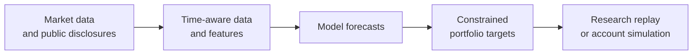

# US Tech Quant v21

**Follow a U.S. equity investment idea from public information to model forecasts, portfolio targets, and simulated orders.**

US Tech Quant is a research and simulation system that makes the steps behind an investment decision inspectable. It connects a time-aware data layer, machine-learning research, portfolio constraints, and account reconciliation in a trilingual workbench.

**[English](README.md) · [中文](docs/README.zh.md) · [日本語](docs/README.ja.md)**

[Overview](#overview) · [Try the demo](#quickstart) · [Architecture](#architecture) · [Engineering](#engineering) · [Research status](#research) · [Verification](#verification) · [Explore the code](#navigation)

<a id="overview"></a>
## What you can learn and do

A model score is one step in a longer decision. The system helps answer four questions:

1. **What was known?** Inspect the source, security identity, and publication time behind an input.
2. **What did the model produce?** Follow a stock score, an action value, or a target exposure in its original meaning.
3. **What can the portfolio hold?** Apply risk and allocation constraints while accounting for existing positions.
4. **What actually happened?** Compare research targets, account targets, orders, and reconciled holdings.

For example, a company filing published at **10:20 New York time** cannot inform a **09:45 decision that morning**. Even a valid later forecast must still pass portfolio and execution checks. This is a hypothetical illustration of the system's timing rules, not a market observation.

### The full workbench in a configured installation

| Area | What a visitor can explore |
| --- | --- |
| Technical gallery | A guided explanation of information timing, features, learning methods, portfolio risk, and simulation |
| Method cases | How a method turns inputs into native outputs, with links to model inspection and portfolio decisions |
| Research records and charts | Source dates, stock history, recorded decisions, coverage gaps, and the evidence available for a selected method |
| Daily simulation | Account targets, current holdings, order differences, and reconciliation status in the existing account component |

The interface supports **Chinese, Japanese, and English**, with research and presentation views. It loads records on demand; the introductory explanations can be explored without loading research histories or models. See the [workbench guide](apps/demo_console/README.md).

### Machine learning in context

The current query catalog contains eight method identities. These include score-based baselines, histogram gradient boosting (HGB), regularized linear models such as ElasticNet and Ridge, tree and neural methods, and exposure-control methods. Their outputs serve different purposes:

| Output | How to read it |
| --- | --- |
| Stock score | A method's assessment or ordering of candidates |
| Action value | A model's value for a particular decision; it is not automatically a portfolio weight |
| Exposure or target weight | A proposed allocation, still subject to its account and execution rules |

A revisable five-method showcase is a presentation choice drawn from that catalog. It is separate from paper-account membership and broker strategy selection. Scores from different methods are not treated as one common ranking. The catalog documents implementations; acceptance and research validity remain method-specific.

<a id="quickstart"></a>
## Try it

### 1. Run the public offline demo

**You need:** Windows, PowerShell, Git, and Python 3.12 available as `python`. The manual simulation uses the Python standard library and built-in synthetic targets and prices.

In a new PowerShell window:

```powershell
git clone https://github.com/kinryukii/us-tech-quant-v21.git
Set-Location us-tech-quant-v21

# Give this demonstration its own state outside the source checkout.
$env:USTQ_DAILY_ROOT = Join-Path $env:LOCALAPPDATA 'US Tech Quant\demo-daily'
$demoState = Join-Path $env:USTQ_DAILY_ROOT ('paper-' + [guid]::NewGuid().ToString('N'))
python -B -m apps.moomoo_trading_component.moomoo_component `
  --repo-root $PWD.Path --data-dir $demoState --port 8766
```

Open [localhost:8766](http://127.0.0.1:8766/), then use these Chinese-labeled controls:

1. **载入离线演示 — Load offline demo:** load synthetic targets and prices.
2. **预览订单与风控 — Preview orders and risk checks:** inspect proposed orders before execution.
3. **执行一轮 — Run once:** execute one manual paper cycle, then inspect holdings and audit records.

The expected result is a simulated account with a traceable target → order → holding sequence. It requires no research dataset, frozen model, Moomoo SDK, or OpenD connection. Keep the demo in manual paper mode; press `Ctrl+C` to stop it. If port 8766 is occupied, use another port such as `--port 18766` and open the matching URL.

### 2. Open the full workbench in a configured installation

The full workbench runs at **[localhost:8506](http://127.0.0.1:8506/)** and embeds the account component on port 8766. Its research views require the external environment, datasets, frozen artifacts, and qualified published records used by that installation.

<details>
<summary>Local launcher, daily updates, and dependencies</summary>

Use a separate PowerShell window from the offline example so its temporary storage override does not carry over:

```powershell
Set-Location D:\us-tech-quant
.\打开DEMO.ps1
```

Opening pages and changing language, date, or presentation mode do not start acquisition, fitting, replay, or orders. For an intentional daily update, use the existing entrypoint:

```powershell
.\更新今日推荐.ps1
```

The update checks whether accepted inputs can be reused and continues eligible unfinished stages. Source checks, separate failure states, and the last verified cutoff remain visible. Use `-RefreshData` when explicitly requesting same-day reacquisition. Reload the published cache after completion; see the [daily-update and recovery guide](docs/daily_recommendation.md).

`requirements.lock.txt` records the base environment. [Workbench dependencies](apps/demo_console/requirements.txt) and [optional broker dependencies](apps/moomoo_trading_component/requirements-moomoo.txt) are maintained separately. The [simulation guide](apps/moomoo_trading_component/README.md) describes paper accounts and optional Moomoo SIMULATE integration; the component does not provide REAL order execution.

</details>

<a id="architecture"></a>
## How the pieces fit together



The workbench reads published records from these stages and exposes their sources, dates, and status. Research replay, local paper accounts, and broker simulation keep their own execution clocks and accounting. A historical research curve and an account's confirmed fills are different records.

| Layer | Main technologies | Responsibility |
| --- | --- | --- |
| Data | Python, Pandas, NumPy, PyArrow, Parquet, SQLite | Query source-aware data while preserving historical identity and availability |
| Modeling | scikit-learn; task-specific boosting and neural libraries | Generate and interpret native forecasts under the applicable research contract |
| Portfolio and replay | Python research modules | Turn forecasts into constrained targets and evaluate account behavior |
| Presentation | Streamlit, Altair, shared readers | Explain mechanisms and inspect published records in three languages |
| Simulation and operations | Python standard library, SQLite, PowerShell | Persist state, reconcile orders, and recover owned processes and daily stages |

Source and small configuration files live in Git. Data, models, experiments, reports, caches, and account state use distinct external roots through one [storage configuration](config/storage_paths.json) and [resolver](scripts/common/storage_paths.py). See the [storage layout](docs/STORAGE_LAYOUT.md) for setup and ownership.

<a id="engineering"></a>
## Engineering choices worth inspecting

### Information is admitted by availability time

A quarterly holdings report describes a reporting period, but it becomes usable only after disclosure. The 13F reconstruction checks timezone-aware acceptance timestamps, the decision cutoff, amendments, and historical security identity. A ticker by itself is insufficient to establish that identity. These checks expose missing or inconsistent evidence instead of filling it from today's mappings.

[Implementation](scripts/v22/pit_13f_reconstruction_r1.py) · [Timing and identity test definitions](scripts/v22/test_fast_a2_r0g1_dynamic_pit_13f_universe_reconstruction_and_exact_r4_rerun.py)

### Forecasts retain their meaning before allocation

A probability, rank, and return forecast are not interchangeable. The bridge keeps each output's original meaning and learns a conversion from past predictions whose outcomes were known before the fitting cutoff. Technically, it fits scaling and a Ridge bridge on chronological out-of-fold (OOF) records, preserving the native forecast coordinates and giving each date equal total weight. Tests check that adding future records does not change an earlier fitted bridge.

[Implementation](scripts/research/a2/ensemble/joint_oof_bridge.py) · [Maturity and future-record test definitions](tests/research/a2/ensemble/test_joint_oof_bridge.py)

### Existing holdings remain part of the problem

A position that cannot currently trade still consumes capital and a position slot. The portfolio policy reserves both before allocating the remainder. An infeasible target produces an explicit fallback rather than implicitly turning holdings into cash; the shared engine's operational exit rules still apply. The position-count solver is deterministic and approximate, without a global-optimality guarantee.

[Implementation](scripts/research/a2/inference/joint_portfolio_policy.py) · [Holding and infeasibility test definitions](tests/research/a2/inference/test_joint_portfolio_policy.py)

### Recovery verifies identity before reusing work

A failed chart update should not silently replace an accepted recommendation. Daily recovery verifies the source, date, active policy, and referenced content before reusing accepted inputs. It continues eligible unfinished branches and preserves separate failures and actual coverage dates. Other required work, such as benchmark refresh, may still run.

[Implementation](scripts/daily_recommendation.py) · [Recovery test definitions](tests/test_daily_recommendation.py)

### An uncertain order stays uncertain until reconciled

A network timeout can occur after a broker has accepted a request. The simulation component persists a stable order intent before sending it, records an unknown outcome explicitly, and stops automatic resubmission when acceptance is uncertain. Acknowledgement is not a confirmed fill. This controls duplicate submission risk; it does not promise distributed exactly-once execution.

[Implementation](apps/moomoo_trading_component/moomoo_component/core.py) · [Order lifecycle test definitions](apps/moomoo_trading_component/tests/test_core.py)

<a id="research"></a>
## Research status and limits

This repository contains maintained applications, research implementations, and retained historical source. The public name remains **v21**; `V22`, `A2`, `FAST3`, and `FAST6` identify internal pipelines and research series. Their names do not indicate an acceptance level.

| Stage | Boundary |
| --- | --- |
| Training and development validation | Content strictly before **2026-01-01**, including preprocessing fits, feature selection, calibration, early stopping, and model selection |
| 2026 evaluation | Observations and targets within **2026-01-01 ≤ time < 2027-01-01**, subject to earlier component cutoffs, actual availability, and outcome maturity |
| Frozen application | Apply the existing transformations and models without updating fitted parameters |

A2's 2026 window has already been exposed, so it cannot be presented as a fresh independent holdout. Showcase selection from exposed records is descriptive. FAST3 remains synthetic-only under its current contract. The [project map](docs/PROJECT_MAP.md) locates the applicable owners and contracts; accepted registries and manifests establish identity and status.

The repository publishes engineering implementations and their evidence paths. Predictive usefulness, economic effectiveness, and live execution readiness each require their own evaluation. Full datasets, model weights, research ledgers, and account state are external to this source distribution.

<a id="verification"></a>
## Verification you can inspect

**Recorded local engineering run, 2026-10-18: 743 passed, 1 skipped.** The skipped Windows PowerShell check was blocked by the local execution policy, which was preserved. This is a dated result, not a live CI badge.

[pytest.ini](pytest.ini) selects reviewed synthetic tests for storage, source/catalog checks, daily coordination, maintenance, and service lifecycle. The research and component test links above show additional suite definitions; they are not all included in that default run.

**Offline first-run check, 2026-10-18:** Python 3.12.10 with third-party package loading disabled completed the synthetic load → preview → execute → holdings/audit flow. Repeating the execution created no additional orders. The check used a new isolated state directory, with paper mode selected and no outbound connection attempts. It verifies the HTTP/API flow; it does not establish browser usability or broker execution behavior. See the [HTTP test definitions](apps/moomoo_trading_component/tests/test_http.py) for related component checks.

<details>
<summary>Reproduce the default suite in the configured local checkout</summary>

Run from the repository root, with a fresh external temporary directory:

```powershell
Set-Location D:\us-tech-quant
$projectPython = 'D:\us-tech-quant-envs\us-tech-quant-main\Scripts\python.exe'
$cacheRoot = (& $projectPython -B -c "from scripts.common.storage_paths import resolve; print(resolve().cache_root)").Trim()
$verificationRoot = Join-Path $cacheRoot ('_maintenance\readme-verification-' + [guid]::NewGuid().ToString('N'))
& $projectPython -B -m pytest -q `
  --basetemp (Join-Path $verificationRoot 'tmp') `
  -o "cache_dir=$(Join-Path $verificationRoot 'pytest-cache')"
```

Keep the configured test selection. Additional legacy or research tests need their imports, data access, subprocesses, and output locations reviewed before execution. This suite is not whole-repository coverage.

</details>

<a id="navigation"></a>
## Explore the code

| If you want to understand… | Start here |
| --- | --- |
| The interface and method explanations | [Workbench guide](apps/demo_console/README.md) |
| Orders, accounts, and reconciliation | [Simulation guide](apps/moomoo_trading_component/README.md) |
| Data and historical availability | [Data-layer guide](docs/DATA_LAYER.md), [DataStore](scripts/storage/storage_r2a.py) |
| Forecasts, risk, and allocation | [Forecast bridge](scripts/research/a2/ensemble/joint_oof_bridge.py), [risk estimation](scripts/research/a2/risk/joint_risk_estimators.py), [portfolio policy](scripts/research/a2/inference/joint_portfolio_policy.py) |
| Research identities and past trials | [Research navigation](docs/research/README.md), [registry](scripts/maintenance/research_registry.py), [lifecycle](scripts/maintenance/prospective_research_lifecycle.py) |
| Daily operation and recovery | [Daily-update guide](docs/daily_recommendation.md) |
| Repository organization and historical source | [Repository layout](docs/governance/REPOSITORY_LAYOUT.md), [retained-source guide](scripts/research/a2/retained/README.md) |
| The wider project | [Project map](docs/PROJECT_MAP.md), [documentation index](docs/README.md) |

<details>
<summary>Terminology for first-time readers</summary>

- **Point-in-time (PIT):** reconstruct inputs using only information available at the decision time.
- **Out-of-fold (OOF):** predictions made for records outside the model's fitting/selection data; here, chronological ordering and outcome maturity also matter.
- **Frozen model:** a recorded model and its transformations applied without refitting or retuning.
- **Portfolio target:** a desired allocation; it is distinct from an order, a fill, or a current holding.
- **Reconciliation:** checking submitted orders and recorded positions against the account's confirmed state.

</details>
