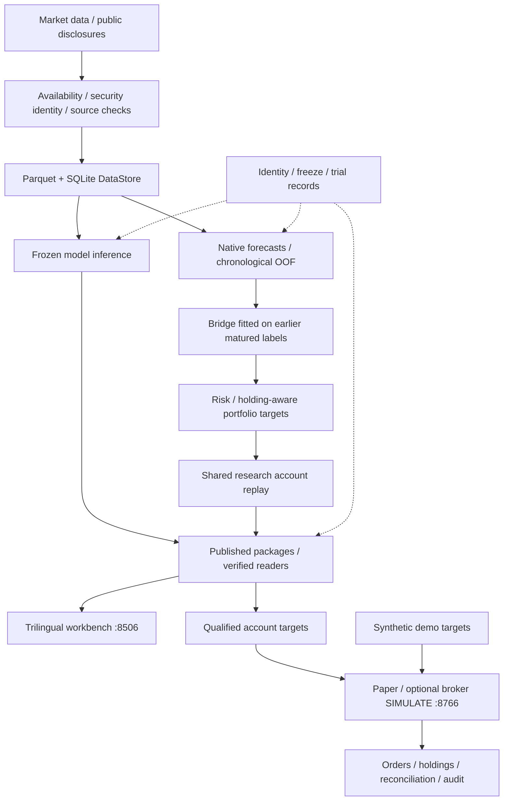

# US Tech Quant v21

**Point-in-time quantitative research, frozen model inference, and simulated execution for U.S. equities.**

[English](README.md) · [中文](docs/README.zh.md) · [日本語](docs/README.ja.md)

[Overview](#overview) · [Architecture](#architecture) · [Engineering](#engineering) · [Research](#research) · [Quickstart](#quickstart) · [Verification](#verification) · [Source guide](#navigation)

Development snapshot: **2026-10-18**. The current product brings technical explanations, method comparisons, research records, data charts, and daily simulation into one trilingual workbench. Source, tests, and small configuration files are published here; datasets, frozen models, account state, and research ledgers remain in their configured external roots.

<a id="overview"></a>
## What is implemented

| Area | Current capability | What the status means |
| --- | --- | --- |
| Data and information availability | Parquet / SQLite DataStore, source lineage, historical security identity, 13F disclosure and amendment timing | Inputs must satisfy the decision's information cutoff; missing identity or source evidence remains explicit |
| Models and portfolios | Native forecasts, chronological out-of-fold bridges, risk estimation, holding-aware portfolio targets, shared account replay | Research implementations and frozen presentation policies retain separate identities and acceptance states |
| Unified workbench | Chinese / Japanese / English; technical gallery, method cases, machine-learning inspection, data charts, and daily simulation | Sections and history load on demand; opening a page does not launch acquisition, fitting, replay, or orders |
| Method presentation | Eight-method query catalog and a revisable five-method showcase | Showcase membership, paper-book membership, and broker strategy binding are distinct; current owner records control them |
| Simulation and reconciliation | Local paper books, optional Moomoo SIMULATE connection, target/holding differences, order lifecycle, and audit trails | Research targets, account targets, simulated fills, and broker-confirmed fills stay separately identified; REAL execution is unavailable |
| Research and storage control | Content-bound identities, failed-trial records, frozen references, external storage routing, and repository size checks | Engineering checks establish the covered behavior; strategy effectiveness needs its own authorized evidence |

The public name retains **v21**. `V22`, `A2`, `FAST3`, and `FAST6` in source paths name internal pipelines or research series. A filename or method's presence in the interface does not establish adoption.

<a id="architecture"></a>
## Architecture



This diagram describes module responsibilities. Research replay, published historical curves, paper accounts, and broker simulation have their own clocks and execution semantics. A displayed research curve is not an account fill record.

Python, Pandas, NumPy, PyArrow, SQLite, and scikit-learn form the main data and modeling stack. Streamlit and Altair power the workbench; the standalone simulation server uses the Python standard library. Optional boosting, neural-model, and broker dependencies belong to their individual components.

<a id="engineering"></a>
## Engineering details

**Reconstruct information as it became available.** The [13F PIT module](scripts/v22/pit_13f_reconstruction_r1.py) uses acceptance timestamps, New York decision cutoffs, amendment semantics, and historical security identity. A filing published after a decision cutoff cannot inform that decision. Quarter-effective manager rosters come from the [shared refresh owner](scripts/storage/refresh_13f_quarter.py).

**Keep model outputs meaningful.** Probabilities, ranks, returns, and quantiles carry different meanings. The [native forecast bridge](scripts/research/a2/ensemble/joint_oof_bridge.py) preserves those coordinates and fits scaling and a Ridge bridge only on earlier out-of-fold records with matured labels. Each date receives equal total weight. Its [tests](tests/research/a2/ensemble/test_joint_oof_bridge.py) define maturity and future-record invariance checks.

**Keep non-tradable holdings in portfolio constraints.** The [portfolio policy](scripts/research/a2/inference/joint_portfolio_policy.py) reserves capital and position slots for locked holdings and preserves actual units when targets cannot be qualified. Its position-count solver is deterministic and approximate, without a guarantee of global optimality. [Tests](tests/research/a2/inference/test_joint_portfolio_policy.py) cover reserved holdings, infeasible targets, and caps.

**Load only the requested presentation.** The [workbench](apps/demo_console/README.md) reuses published readers and shared account components. Method explanations do not load models or generate results. Missing records, qualification failures, and different source dates remain visible; changing language or presentation mode does not change the underlying research or account authority.

<a id="research"></a>
## Research boundaries

Training and development validation, including preprocessing fits, feature selection, calibration, early stopping, and model selection, must use content strictly before **2026-01-01**. Test observations and targets are limited to **2026-01-01 ≤ time < 2027-01-01**, subject to earlier component cutoffs, actual availability, and label maturity.

A2's 2026 window has already been exposed and cannot be described as a pristine independent holdout. Frozen inference applies existing transformations and models without updating their fitted state. Historical failures and frozen identities remain part of the evidence. FAST3 development remains synthetic-only under its existing contract; protected confirmation content is not an ordinary development input.

The interface explains native methods and their decision chains. It does not turn an exploratory implementation into an accepted strategy or rank methods as universally optimal. The [project map](docs/PROJECT_MAP.md) locates owners and contracts; the accepted registries and manifests establish identity and status.

<a id="quickstart"></a>
## Run the project

### Public source: offline simulation

Requires Windows, PowerShell, and Python 3.12 on PATH. This manual demonstration uses synthetic targets and prices and needs no Streamlit, Moomoo SDK, OpenD, or research dataset.

Run in a separate PowerShell window, using a new external state directory:

```powershell
git clone https://github.com/kinryukii/us-tech-quant-v21.git
Set-Location us-tech-quant-v21
$env:USTQ_DAILY_ROOT = Join-Path $env:LOCALAPPDATA 'US Tech Quant\demo-daily'
$demoState = Join-Path $env:USTQ_DAILY_ROOT ('paper-' + [guid]::NewGuid().ToString('N'))
python -B -m apps.moomoo_trading_component.moomoo_component `
  --repo-root $PWD.Path --data-dir $demoState --port 8766
```

Open [the simulation workbench](http://127.0.0.1:8766/). Follow **载入离线演示 (Load offline demo) → 预览订单与风控 (Preview orders and risk checks) → 执行一轮 (Run once)**, then inspect holdings and audit records. Keep the demonstration in manual paper mode. Press `Ctrl+C` to stop it.

### Configured local installation: unified workbench

The full workbench requires the external `demo-console` environment and qualified published artifacts. Run its existing product launcher:

```powershell
Set-Location D:\us-tech-quant
.\打开DEMO.ps1
```

Open [the unified workbench](http://127.0.0.1:8506/). The account component is embedded from port **8766**. Opening the workbench does not itself activate strategy scheduling. Actual research records require their applicable access scope; cloning source does not provide external datasets or frozen models.

For an explicitly intended daily update in the configured installation:

```powershell
.\更新今日推荐.ps1
```

The update resumes accepted stages and preserves source checks, locks, resource gates, and the last verified cutoff. Use `-RefreshData` only when intentionally requesting same-day reacquisition. Reload the published cache in the workbench after completion. See the [daily-update guide](docs/daily_recommendation.md) for prerequisites and recovery.

`requirements.lock.txt` is the base-environment snapshot. [Workbench dependencies](apps/demo_console/requirements.txt) and [optional broker dependencies](apps/moomoo_trading_component/requirements-moomoo.txt) are maintained separately.

<a id="verification"></a>
## Verification

On **2026-10-18**, the configured default synthetic suite completed with **743 passed, 1 skipped**. The skipped Windows PowerShell check was blocked by the local execution policy; that policy was preserved. This result covers the selected engineering tests.

The default acceptance suite is explicitly scoped by [pytest.ini](pytest.ini) to reviewed synthetic storage, maintenance, daily-coordinator, and service-lifecycle tests. Run from the configured repository root without adding a broad test directory:

```powershell
Set-Location D:\us-tech-quant
$projectPython = 'D:\us-tech-quant-envs\us-tech-quant-main\Scripts\python.exe'
$cacheRoot = (& $projectPython -B -c "from scripts.common.storage_paths import resolve; print(resolve().cache_root)").Trim()
$verificationRoot = Join-Path $cacheRoot ('_maintenance\readme-verification-' + [guid]::NewGuid().ToString('N'))
& $projectPython -B -m pytest -q `
  --basetemp (Join-Path $verificationRoot 'tmp') `
  -o "cache_dir=$(Join-Path $verificationRoot 'pytest-cache')"
```

Additional component and research tests require a review of their imports, inputs, subprocesses, and output scope. The default suite is not whole-repository coverage. This synchronization does not acquire provider history, run real-data research, start existing accounts, or validate live trading.

<a id="navigation"></a>
## Source guide

| Purpose | Entry point |
| --- | --- |
| Unified workbench and presentation behavior | [Workbench README](apps/demo_console/README.md) |
| Simulation, account bindings, and order lifecycle | [Simulation component README](apps/moomoo_trading_component/README.md) |
| Daily publication and recovery | [Daily-update guide](docs/daily_recommendation.md) |
| Project navigation and evidence rules | [Project map](docs/PROJECT_MAP.md), [documentation index](docs/README.md) |
| Data catalog and PIT inputs | [Data-layer guide](docs/DATA_LAYER.md), [DataStore](scripts/storage/storage_r2a.py) |
| Native forecasts and portfolio research | [OOF bridge](scripts/research/a2/ensemble/joint_oof_bridge.py), [risk estimation](scripts/research/a2/risk/joint_risk_estimators.py), [portfolio policy](scripts/research/a2/inference/joint_portfolio_policy.py) |
| Research identity and failed trials | [Registry](scripts/maintenance/research_registry.py), [lifecycle](scripts/maintenance/prospective_research_lifecycle.py) |
| Repository layout and retired-source recovery | [Layout](docs/governance/REPOSITORY_LAYOUT.md), [research navigation](docs/research/README.md) |
| Storage and size policy | [Storage guide](docs/STORAGE_LAYOUT.md), [Anti-Bloat policy](docs/governance/ANTI_BLOAT_POLICY.md) |

The [shared configuration](config/storage_paths.json) and [resolver](scripts/common/storage_paths.py) route data, environments, caches, experiments, reports, and daily state to distinct external roots. These runtime assets are preserved separately from the GitHub source snapshot.
