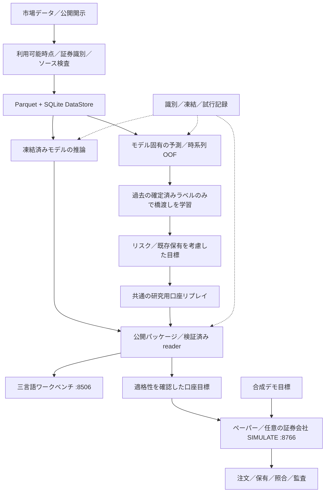

# US Tech Quant v21

**米国株を対象に、情報の利用可能時点を守る定量研究、凍結済みモデルの推論、シミュレーション実行を行うプロジェクト。**

[English](../README.md) · [中文](README.zh.md) · [日本語](README.ja.md)

[概要](#overview) · [アーキテクチャ](#architecture) · [技術設計](#engineering) · [研究上の境界](#research) · [クイックスタート](#quickstart) · [検証](#verification) · [ソースコード案内](#navigation)

開発状況：**2026-10-18**。現在の製品では、技術解説、手法の比較、研究記録、データチャート、日次シミュレーションを、中日英の三言語に対応した一つのワークベンチに統合しています。ここではソースコード、テスト、小規模な設定を公開し、データセット、凍結済みモデル、口座状態、研究台帳は、それぞれ設定済みの外部保存先に保持します。

<a id="overview"></a>
## 実装済みの機能

| 領域 | 現在の機能 | 状態の意味 |
| --- | --- | --- |
| データと情報の利用可能性 | Parquet / SQLite DataStore、ソースの来歴、過去の証券識別、13F の開示・訂正時点 | 入力は判断時点の情報制限を満たす必要があり、識別や出所の証拠が欠けている場合は明示します |
| モデルとポートフォリオ | モデル固有の予測、時系列の out-of-fold 予測の橋渡し、リスク推定、既存保有を考慮した目標、共通の口座リプレイ | 研究実装と凍結済みの表示用ポリシーは、識別情報と受入状態を別々に保持します |
| 統合ワークベンチ | 中国語／日本語／英語、技術ギャラリー、手法別事例、機械学習の確認、データチャート、日次シミュレーション | 各区画と履歴は必要時に読み込みます。ページを開くだけでは取得、学習、リプレイ、発注を開始しません |
| 手法の展示 | 8 手法を検索できるカタログと、改訂可能な 5 手法の展示枠 | 展示対象、ペーパー口座の構成、証券会社口座の戦略割当は別々に管理し、各管理元の現在の記録に従います |
| シミュレーションと照合 | ローカルのペーパー台帳、任意の Moomoo SIMULATE 接続、目標と保有の差分、注文ライフサイクル、監査記録 | 研究目標、口座目標、ペーパー約定、証券会社で確認した約定を区別します。REAL 発注機能はありません |
| 研究とストレージの管理 | 内容にひもづく識別情報、失敗試行の記録、凍結参照、外部保存先への振り分け、リポジトリ容量検査 | 工学的検証が示すのは対象範囲の動作です。戦略の有効性には、別途承認された証拠が必要です |

公開名称は **v21** を維持しています。ソースパス中の `V22`、`A2`、`FAST3`、`FAST6` は、内部パイプラインや研究系列の名称です。ファイル名や画面上に手法が存在することだけでは、採用済みとは判断できません。

<a id="architecture"></a>
## アーキテクチャ



この図は各モジュールの役割を示します。研究リプレイ、公開済みの過去の曲線、ペーパー口座、証券会社のシミュレーションは、それぞれ固有の時刻と実行上の意味を持ちます。画面の研究曲線は、口座の約定記録ではありません。

データ処理とモデリングの中心は Python、Pandas、NumPy、PyArrow、SQLite、scikit-learn です。ワークベンチには Streamlit と Altair、単独のシミュレーションサーバーには Python 標準ライブラリを使用します。任意のブースティング、ニューラルモデル、証券会社接続の依存関係は、各コンポーネントで管理します。

<a id="engineering"></a>
## 技術設計

**利用可能になった時点に沿って情報を再構成します。** [13F PIT モジュール](../scripts/v22/pit_13f_reconstruction_r1.py) は、受理時刻、ニューヨーク時間での判断締切、訂正の意味、過去の証券識別を使います。判断締切後に公開された開示は、その判断に利用できません。四半期ごとに有効となる運用者リストは、[共通の更新モジュール](../scripts/storage/refresh_13f_quarter.py) が提供します。

**モデル出力の本来の意味を保ちます。** 確率、順位、リターン、分位点は異なる意味を持ちます。[モデル固有の予測を扱うブリッジ](../scripts/research/a2/ensemble/joint_oof_bridge.py) はそれぞれの座標系を保ち、過去の out-of-fold 記録のうちラベルが確定したものだけで、スケーリングと Ridge ブリッジを学習します。日付ごとの合計重みは等しくします。[テスト](../tests/research/a2/ensemble/test_joint_oof_bridge.py) では、ラベル確定の境界と、将来の記録を追加しても過去の学習結果が変わらないことを確認します。

**売買できない保有もポートフォリオ制約に含めます。** [ポートフォリオポリシー](../scripts/research/a2/inference/joint_portfolio_policy.py) は、固定された保有に資金と銘柄枠を確保し、目標の適格性を確認できない場合には実際の保有数量を維持します。銘柄数の制約には決定論的な近似ソルバーを使用し、大域的最適性は保証しません。[テスト](../tests/research/a2/inference/test_joint_portfolio_policy.py) は、既存保有の確保、実現不能な目標、上限制約を対象とします。

**要求された表示だけを読み込みます。** [ワークベンチ](../apps/demo_console/README.md) は、公開済みデータの reader と共通の口座コンポーネントを再利用します。手法解説はモデルを読み込まず、研究結果も生成しません。記録の欠落、適格性検査の失敗、ソース日付の違いを明示し、言語や表示モードを切り替えても、研究条件や口座権限は変わりません。

<a id="research"></a>
## 研究上の境界

前処理の推定、特徴量選択、校正、早期停止、モデル選択を含む学習と開発検証には、**2026-01-01 より前**の内容だけを使用します。テストの観測と目的変数は **2026-01-01 ≤ 時刻 < 2027-01-01** に限定し、各コンポーネントのより早い締切、実際の情報利用可能性、ラベル確定の要件にも従います。

A2 の 2026 年期間は既に参照済みであり、未参照の独立ホールドアウトとは呼べません。凍結推論では既存の変換とモデルを適用するだけで、学習済み状態は更新しません。過去の失敗と凍結済みの識別情報も証拠として保持します。FAST3 の開発は既存契約に従い合成データのみを対象とし、保護された Confirmation の内容を通常開発の入力には使いません。

画面では各手法の固有の出力と判断過程を説明します。探索段階の実装を採用済み戦略に変えたり、ある手法を普遍的な最良手法と位置づけたりするものではありません。[プロジェクトマップ](../docs/PROJECT_MAP.md) は管理元と契約を探す入口であり、識別と状態は受理済みのレジストリと manifest が決定します。

<a id="quickstart"></a>
## プロジェクトの実行

### 公開ソース：オフラインシミュレーション

Windows、PowerShell、PATH 上の Python 3.12 が必要です。この手動デモは合成した目標と価格を使い、Streamlit、Moomoo SDK、OpenD、研究データセットを必要としません。

別の PowerShell ウィンドウで実行し、新しい外部状態ディレクトリを作成します。

```powershell
git clone https://github.com/kinryukii/us-tech-quant-v21.git
Set-Location us-tech-quant-v21
$env:USTQ_DAILY_ROOT = Join-Path $env:LOCALAPPDATA 'US Tech Quant\demo-daily'
$demoState = Join-Path $env:USTQ_DAILY_ROOT ('paper-' + [guid]::NewGuid().ToString('N'))
python -B -m apps.moomoo_trading_component.moomoo_component `
  --repo-root $PWD.Path --data-dir $demoState --port 8766
```

[シミュレーションワークベンチ](http://127.0.0.1:8766/) を開き、**载入离线演示（オフラインデモ読込）→ 预览订单与风控（注文・リスク確認）→ 执行一轮（1 回実行）** の順に操作して、保有と監査記録を確認します。デモは手動ペーパーモードのまま使用してください。終了するには `Ctrl+C` を押します。

### 設定済みのローカル環境：統合ワークベンチ

完全なワークベンチには、外部の `demo-console` 環境と、適格性を確認した公開済み成果物が必要です。既存の製品ランチャーを使います。

```powershell
Set-Location D:\us-tech-quant
.\打开DEMO.ps1
```

[統合ワークベンチ](http://127.0.0.1:8506/) を開きます。口座コンポーネントはポート **8766** から埋め込まれます。ワークベンチを開くだけでは戦略のスケジューラーは有効になりません。実際の研究記録には対象範囲のアクセス権限が必要です。ソースを clone しても、外部データセットや凍結済みモデルは含まれません。

設定済み環境で日次更新を明示的に行う場合は、次を実行します。

```powershell
.\更新今日推荐.ps1
```

更新は受理済みの段階から再開し、ソース検査、ロック、リソース条件、最後に検証した締切を維持します。同日の再取得を意図する場合に限り、`-RefreshData` を使用します。完了後、ワークベンチで公開済みキャッシュを再読み込みしてください。前提条件と復旧方法は[日次更新ガイド](../docs/daily_recommendation.md)を参照してください。

`requirements.lock.txt` は基本環境のスナップショットです。[ワークベンチの依存関係](../apps/demo_console/requirements.txt)と[任意の証券会社接続の依存関係](../apps/moomoo_trading_component/requirements-moomoo.txt)は別々に管理しています。

<a id="verification"></a>
## 検証

**2026-10-18**、設定済みの既定の合成テストは **743 passed, 1 skipped** で完了しました。Windows PowerShell の一項目はローカルの実行ポリシーによってスキップされ、ポリシーは変更していません。この結果は指定されたエンジニアリングテストを対象とします。

[pytest.ini](../pytest.ini) は、既定の受入テストを、審査済みの合成データによるストレージ、保守、日次処理の調整、サービスライフサイクルのテストに明示的に限定します。設定済みリポジトリのルートから、広範なテストディレクトリを追加せずに実行します。

```powershell
Set-Location D:\us-tech-quant
$projectPython = 'D:\us-tech-quant-envs\us-tech-quant-main\Scripts\python.exe'
$cacheRoot = (& $projectPython -B -c "from scripts.common.storage_paths import resolve; print(resolve().cache_root)").Trim()
$verificationRoot = Join-Path $cacheRoot ('_maintenance\readme-verification-' + [guid]::NewGuid().ToString('N'))
& $projectPython -B -m pytest -q `
  --basetemp (Join-Path $verificationRoot 'tmp') `
  -o "cache_dir=$(Join-Path $verificationRoot 'pytest-cache')"
```

追加のコンポーネント・研究テストでは、インポート、入力、子プロセス、出力範囲を事前に確認する必要があります。既定のテストはリポジトリ全体を網羅しません。今回の同期では、プロバイダーからの過去データ取得、実データ研究、既存口座の起動、実取引の検証は行いません。

<a id="navigation"></a>
## ソースコード案内

| 用途 | 入口 |
| --- | --- |
| 統合ワークベンチと表示の動作 | [ワークベンチ README](../apps/demo_console/README.md) |
| シミュレーション、口座割当、注文ライフサイクル | [シミュレーションコンポーネント README](../apps/moomoo_trading_component/README.md) |
| 日次公開と復旧 | [日次更新ガイド](../docs/daily_recommendation.md) |
| プロジェクトの案内と証拠の規則 | [プロジェクトマップ](../docs/PROJECT_MAP.md)、[文書索引](../docs/README.md) |
| データカタログと PIT 入力 | [データ層ガイド](../docs/DATA_LAYER.md)、[DataStore](../scripts/storage/storage_r2a.py) |
| モデル固有の予測とポートフォリオ研究 | [OOF ブリッジ](../scripts/research/a2/ensemble/joint_oof_bridge.py)、[リスク推定](../scripts/research/a2/risk/joint_risk_estimators.py)、[ポートフォリオポリシー](../scripts/research/a2/inference/joint_portfolio_policy.py) |
| 研究の識別と失敗試行 | [レジストリ](../scripts/maintenance/research_registry.py)、[ライフサイクル](../scripts/maintenance/prospective_research_lifecycle.py) |
| リポジトリ構成と廃止ソースの復元 | [構成ガイド](../docs/governance/REPOSITORY_LAYOUT.md)、[研究案内](../docs/research/README.md) |
| ストレージと容量の規則 | [ストレージガイド](../docs/STORAGE_LAYOUT.md)、[Anti-Bloat ポリシー](../docs/governance/ANTI_BLOAT_POLICY.md) |

[共通設定](../config/storage_paths.json)と[パスリゾルバー](../scripts/common/storage_paths.py)は、データ、環境、キャッシュ、実験、報告、日次状態を、それぞれ異なる外部保存先へ振り分けます。これらの実行時資産は、GitHub のソーススナップショットとは別に保持します。
