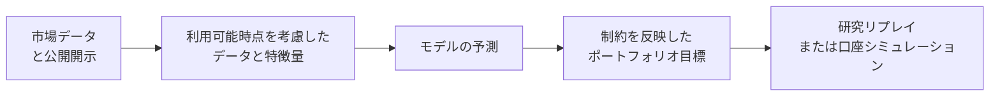

# US Tech Quant v21

**米国株の投資アイデアを、公開情報からモデルの予測、ポートフォリオの目標、模擬注文まで追いかける。**

US Tech Quant は、投資判断に至る各段階を確認できる研究・シミュレーションシステムです。情報を利用できる時点を考慮したデータ層、機械学習の研究、ポートフォリオの制約、口座の照合を、三言語対応のワークベンチにつなげています。

**[English](../README.md) · [中文](README.zh.md) · [日本語](README.ja.md)**

[概要](#overview) · [デモを試す](#quickstart) · [全体構成](#architecture) · [技術設計](#engineering) · [研究の現状](#research) · [検証](#verification) · [コードを読む](#navigation)

<a id="overview"></a>
## このプロジェクトで分かること・できること

モデルが出すスコアは、投資判断の一段階です。このシステムでは、次の四つの問いをたどれます。

1. **その時点で何が分かっていたか？** 入力の出所、銘柄を特定する情報、公表時刻を確認します。
2. **モデルは何を出力したか？** 銘柄スコア、行動価値、目標エクスポージャーを、それぞれ本来の意味を保ったまま追跡します。
3. **ポートフォリオに何を保有できるか？** 既存の保有を考慮しながら、リスクと配分の制約を適用します。
4. **実際に何が起きたか？** 研究上の目標、口座の目標、注文、照合済みの保有を比較します。

例えば、**ニューヨーク時間の 10:20** に公表された企業の開示資料は、**同日の 09:45 の判断**には使えません。その後の時刻に有効な予測が得られても、ポートフォリオと執行の確認は必要です。これは情報の利用時点に関するルールを説明する仮想例であり、実際の市場観測ではありません。

### 設定済み環境で利用するフルワークベンチ

| 領域 | 確認できること |
| --- | --- |
| 技術ギャラリー | 情報の利用時点、特徴量、学習手法、ポートフォリオのリスク、シミュレーションを順に解説 |
| 手法別の事例 | 入力から各手法固有の出力が得られるまでの流れと、モデルの確認・ポートフォリオ判断への案内 |
| 研究記録とチャート | データの基準日、銘柄の履歴、記録済みの判断、対象期間の欠落、選択した手法について確認できる証拠 |
| 日次シミュレーション | 既存の口座コンポーネントによる口座目標、現在の保有、注文差分、照合状況 |

画面は**中国語・日本語・英語**に対応し、研究用と説明用の表示を備えています。記録は必要なときに読み込みます。導入の解説は、研究履歴やモデルを読み込まずに閲覧できます。詳しくは[ワークベンチガイド](../apps/demo_console/README.md)を参照してください。

### 機械学習を投資判断の中で捉える

現在の検索カタログには、識別情報を持つ 8 手法が登録されています。スコアに基づくベースライン、ヒストグラム勾配ブースティング（HGB）、ElasticNet や Ridge などの正則化線形モデル、木・ニューラルネットワークを使う手法、エクスポージャーを制御する手法が含まれます。出力の用途はそれぞれ異なります。

| 出力 | 読み方 |
| --- | --- |
| 銘柄スコア | 候補に対する、その手法による評価や順位付け |
| 行動価値 | 特定の判断に対してモデルが見積もる価値。そのままポートフォリオの配分比率になるわけではありません |
| エクスポージャー・目標配分比率 | 配分の提案。口座と執行のルールは別途適用されます |

カタログから選ぶ 5 手法の展示枠は、見せ方のための選択であり、変更できます。ペーパー口座の構成や証券会社側の戦略選択とは別です。異なる手法のスコアを一つの共通ランキングとして扱うことはしません。カタログは実装を記録するもので、受入状況と研究上の妥当性は手法ごとに判断します。

<a id="quickstart"></a>
## 試してみる

### 1. 公開オフラインデモを動かす

**必要なもの：** Windows、PowerShell、Git、および `python` コマンドで使える Python 3.12。手動シミュレーションは Python 標準ライブラリと、組み込みの合成目標・価格を使います。

新しい PowerShell ウィンドウで実行します。

```powershell
git clone https://github.com/kinryukii/us-tech-quant-v21.git
Set-Location us-tech-quant-v21

# Give this demonstration its own state outside the source checkout.
$env:USTQ_DAILY_ROOT = Join-Path $env:LOCALAPPDATA 'US Tech Quant\demo-daily'
$demoState = Join-Path $env:USTQ_DAILY_ROOT ('paper-' + [guid]::NewGuid().ToString('N'))
python -B -m apps.moomoo_trading_component.moomoo_component `
  --repo-root $PWD.Path --data-dir $demoState --port 8766
```

[localhost:8766](http://127.0.0.1:8766/) を開き、次の中国語表記のボタンを操作します。

1. **载入离线演示 — オフラインデモを読み込む：** 合成の目標と価格を読み込みます。
2. **预览订单与风控 — 注文とリスクチェックをプレビュー：** 実行前に注文案を確認します。
3. **执行一轮 — 1 回実行：** ペーパー取引を手動で 1 サイクル実行し、保有と監査記録を確認します。

目標 → 注文 → 保有をたどれる模擬口座が、期待される結果です。研究データセット、凍結済みモデル、Moomoo SDK、OpenD 接続は不要です。デモは手動のペーパーモードで使い、終了時は `Ctrl+C` を押してください。ポート 8766 が使用中なら、`--port 18766` など別のポートを指定し、対応する URL を開きます。

### 2. 設定済み環境でフルワークベンチを開く

フルワークベンチは **[localhost:8506](http://127.0.0.1:8506/)** で動作し、ポート 8766 の口座コンポーネントを組み込みます。研究用の表示には、その環境で使う外部の実行環境、データセット、凍結済み成果物、適格性を確認して公開した記録が必要です。

<details>
<summary>ローカル起動、日次更新、依存関係</summary>

オフラインデモで一時的に設定した保存先を引き継がないよう、別の PowerShell ウィンドウを使います。

```powershell
Set-Location D:\us-tech-quant
.\打开DEMO.ps1
```

ページを開いたり、言語・日付・表示モードを切り替えたりしても、データ取得、学習、リプレイ、発注は始まりません。日次更新を行う場合は、既存の入口を使います。

```powershell
.\更新今日推荐.ps1
```

更新処理は、受入済みの入力を再利用できるか確認し、再開条件を満たす未完了の段階を続行します。出所の確認、個別の失敗状態、最後に検証した対象時点を確認できます。同日分の再取得を明示的に行う場合は `-RefreshData` を使います。完了後、公開済みキャッシュを再読み込みしてください。詳しくは[日次更新と復旧のガイド](daily_recommendation.md)を参照してください。

`requirements.lock.txt` に基本環境を記録しています。[ワークベンチの依存関係](../apps/demo_console/requirements.txt)と[任意のブローカー接続用依存関係](../apps/moomoo_trading_component/requirements-moomoo.txt)は別途管理しています。[シミュレーションガイド](../apps/moomoo_trading_component/README.md)では、ペーパー口座と任意の Moomoo SIMULATE 接続を説明しています。このコンポーネントは REAL 発注機能を提供しません。

</details>

<a id="architecture"></a>
## 各部分のつながり



ワークベンチは各段階の公開済み記録を読み取り、出所、日付、状態を表示します。研究リプレイ、ローカルのペーパー口座、証券会社のシミュレーションは、それぞれ独自の執行時刻と会計記録を持ちます。過去の研究曲線と、口座で確認された約定は別の記録です。

| 層 | 主な技術 | 役割 |
| --- | --- | --- |
| データ | Python、Pandas、NumPy、PyArrow、Parquet、SQLite | 過去の銘柄識別と情報の利用可能時点を保ちながら、出所を追えるデータを検索 |
| モデリング | scikit-learn、用途に応じたブースティング・ニューラルネットワークのライブラリ | 適用される研究契約の下で、各モデル固有の予測を生成・解釈 |
| ポートフォリオとリプレイ | Python の研究モジュール | 予測を制約付きの目標に変換し、口座の動作を評価 |
| 表示 | Streamlit、Altair、共通の読み取り処理 | 仕組みを三言語で説明し、公開済み記録を確認 |
| シミュレーションと運用 | Python 標準ライブラリ、SQLite、PowerShell | 状態の永続化、注文の照合、管理対象プロセスと日次処理の復旧 |

ソースコードと小規模な設定ファイルは Git で管理します。データ、モデル、実験、レポート、キャッシュ、口座状態は、一つの[保存先設定](../config/storage_paths.json)と[解決処理](../scripts/common/storage_paths.py)を通じて、それぞれ異なる外部ルートに保存します。設定と管理範囲は[ストレージ構成](STORAGE_LAYOUT.md)を参照してください。

<a id="engineering"></a>
## 注目してほしい技術設計

### 情報を利用できる時点で入力を制限する

四半期の保有報告は過去の報告期間について記載しますが、利用できるのは開示後です。13F の再構成では、タイムゾーン付きの受理時刻、判断に用いる情報の締切時点、訂正、過去の銘柄識別を確認します。ティッカーだけでは、同じ証券であることを確定できません。証拠の欠落や不整合は現在の対応表で補わず、明示します。

[実装](../scripts/v22/pit_13f_reconstruction_r1.py) · [時点・銘柄識別のテスト定義](../scripts/v22/test_fast_a2_r0g1_dynamic_pit_13f_universe_reconstruction_and_exact_r4_rerun.py)

### 配分に変換する前も予測本来の意味を保つ

確率、順位、リターン予測は同じものではありません。橋渡しの処理は、各出力本来の意味を保ち、学習の締切時点より前に結果が分かっていた過去の予測から変換を学びます。具体的には、時系列順の out-of-fold（OOF）記録でスケーリングと Ridge による変換を学習し、モデル固有の予測座標を保ちながら、各日付の重みの合計を等しくします。将来の記録を追加しても、過去の時点で学習した変換が変わらないことをテストで確認します。

[実装](../scripts/research/a2/ensemble/joint_oof_bridge.py) · [結果の確定時点・将来記録のテスト定義](../tests/research/a2/ensemble/test_joint_oof_bridge.py)

### 既存の保有も配分の計算に含める

現在売買できない保有銘柄も、資金と保有銘柄数の枠を使います。ポートフォリオの方針は、両方を確保してから残りを配分します。実現できない目標には明示的な代替処理を適用し、保有を暗黙に現金とみなすことはしません。共通エンジンの運用上の手仕舞いルールは引き続き適用されます。保有銘柄数を扱うソルバーは決定的な近似解法であり、大域的な最適解を保証しません。

[実装](../scripts/research/a2/inference/joint_portfolio_policy.py) · [既存保有・実現不能時のテスト定義](../tests/research/a2/inference/test_joint_portfolio_policy.py)

### 再利用する前に復旧対象を確認する

チャートの更新に失敗しても、受入済みの推奨が知らないうちに置き換わるべきではありません。日次処理の復旧では、受入済み入力を再利用する前に、出所、日付、有効な方針、参照先の内容を確認します。再開条件を満たす未完了の分岐を続行し、個別の失敗と実際に対象となった期間を保持します。ベンチマークの更新など、ほかの必要な処理が実行される場合もあります。

[実装](../scripts/daily_recommendation.py) · [復旧のテスト定義](../tests/test_daily_recommendation.py)

### 結果不明の注文は照合まで不明のまま扱う

証券会社がリクエストを受け付けた後に、通信がタイムアウトすることがあります。シミュレーションコンポーネントは送信前に一貫した注文意図を永続化し、結果が不明であることを明示的に記録します。受理されたか不明な場合は、自動再送を止めます。受付応答は、約定の確認ではありません。これにより重複送信のリスクを抑えますが、分散システム全体で厳密に一度だけ実行されることを保証するものではありません。

[実装](../apps/moomoo_trading_component/moomoo_component/core.py) · [注文ライフサイクルのテスト定義](../apps/moomoo_trading_component/tests/test_core.py)

<a id="research"></a>
## 研究の現状と限界

このリポジトリには、保守中のアプリケーション、研究実装、保持している過去のソースコードが含まれます。公開名称は **v21** のままです。`V22`、`A2`、`FAST3`、`FAST6` は内部パイプラインや研究系列の識別名であり、受入の水準を表すものではありません。

| 段階 | 境界 |
| --- | --- |
| 学習・開発時の検証 | **2026-01-01 より厳密に前**の内容のみ。前処理の学習、特徴量選択、校正、早期停止、モデル選択も含みます |
| 2026 年の評価 | 観測と評価対象は **2026-01-01 ≤ time < 2027-01-01** の範囲。各コンポーネントのより早い締切時点、実際の情報利用可能性、結果の確定時点にも従います |
| 凍結済みモデルの適用 | 学習済みパラメーターを更新せず、既存の変換とモデルを適用します |

A2 の 2026 年の評価期間はすでに参照されているため、未参照の独立ホールドアウトとして扱うことはできません。参照済み記録からの展示対象の選択は、記述的なものです。FAST3 は現行の契約により、引き続き合成データのみを対象とします。[プロジェクトマップ](PROJECT_MAP.md)から適用される管理元と契約をたどれます。識別情報と状態を確定するのは、受入済みのレジストリとマニフェストです。

このリポジトリは、技術実装とその証拠への参照先を公開します。予測の有用性、経済的な有効性、実取引への対応状況は、それぞれ別の評価が必要です。完全なデータセット、モデルの重み、研究台帳、口座状態は、配布するソースコードの外部にあります。

<a id="verification"></a>
## 確認できる検証結果

**2026-10-18 のローカル技術検証記録：743 件成功、1 件スキップ。** スキップした Windows PowerShell の確認は、ローカルの実行ポリシーによって阻止されたもので、ポリシーは変更していません。これは特定の日付の結果であり、現在の CI 状態を示すバッジではありません。

[pytest.ini](../pytest.ini) は、ストレージ、ソース・カタログの確認、日次処理の調整、保守、サービスのライフサイクルを対象とする、レビュー済みの合成テストを選択しています。上記の研究・コンポーネントのテストリンクは追加のテスト定義を示しており、すべてがこの標準実行に含まれるわけではありません。

**2026-10-18 のオフライン初回実行確認：** サードパーティーパッケージの読み込みを無効にした Python 3.12.10 で、合成データの読み込み → プレビュー → 実行 → 保有・監査記録の確認まで完了しました。実行を繰り返しても注文は追加されませんでした。確認には新しい独立した状態保存ディレクトリを使い、ペーパーモードを選択し、外部への接続試行はありませんでした。確認したのは HTTP/API の一連の動作であり、ブラウザーでの使いやすさや証券会社側の執行動作を確立するものではありません。関連するコンポーネントの確認は [HTTP テスト定義](../apps/moomoo_trading_component/tests/test_http.py)を参照してください。

<details>
<summary>設定済みのローカルチェックアウトで標準テストを再現する</summary>

新しい外部の一時ディレクトリを指定し、リポジトリのルートから実行します。

```powershell
Set-Location D:\us-tech-quant
$projectPython = 'D:\us-tech-quant-envs\us-tech-quant-main\Scripts\python.exe'
$cacheRoot = (& $projectPython -B -c "from scripts.common.storage_paths import resolve; print(resolve().cache_root)").Trim()
$verificationRoot = Join-Path $cacheRoot ('_maintenance\readme-verification-' + [guid]::NewGuid().ToString('N'))
& $projectPython -B -m pytest -q `
  --basetemp (Join-Path $verificationRoot 'tmp') `
  -o "cache_dir=$(Join-Path $verificationRoot 'pytest-cache')"
```

設定済みのテスト選択を維持してください。過去のテストや研究用テストを追加で実行する場合は、事前にインポート、データアクセス、子プロセス、出力先を確認する必要があります。このテスト一式は、リポジトリ全体を網羅するものではありません。

</details>

<a id="navigation"></a>
## コードを読む

| 知りたいこと | 読み始める場所 |
| --- | --- |
| 画面と手法の説明 | [ワークベンチガイド](../apps/demo_console/README.md) |
| 注文、口座、照合 | [シミュレーションガイド](../apps/moomoo_trading_component/README.md) |
| データと過去の利用可能時点 | [データ層ガイド](DATA_LAYER.md)、[DataStore](../scripts/storage/storage_r2a.py) |
| 予測、リスク、配分 | [予測の橋渡し](../scripts/research/a2/ensemble/joint_oof_bridge.py)、[リスク推定](../scripts/research/a2/risk/joint_risk_estimators.py)、[ポートフォリオ方針](../scripts/research/a2/inference/joint_portfolio_policy.py) |
| 研究の識別情報と過去の試行 | [研究案内](research/README.md)、[レジストリ](../scripts/maintenance/research_registry.py)、[ライフサイクル](../scripts/maintenance/prospective_research_lifecycle.py) |
| 日々の運用と復旧 | [日次更新ガイド](daily_recommendation.md) |
| リポジトリの構成と過去のソース | [リポジトリ構成](governance/REPOSITORY_LAYOUT.md)、[保持ソースガイド](../scripts/research/a2/retained/README.md) |
| プロジェクト全体 | [プロジェクトマップ](PROJECT_MAP.md)、[ドキュメント索引](README.md) |

<details>
<summary>初めて読む方のための用語集</summary>

- **Point-in-time（PIT）：** 判断時点で利用できた情報だけを使って入力を再構成すること。
- **Out-of-fold（OOF）：** モデルの学習・選択に使ったデータの外側にある記録に対する予測。このプロジェクトでは、時系列の順序と結果が確定する時点も重要です。
- **凍結済みモデル：** 再学習や再調整をせずに適用する、記録済みのモデルとその変換。
- **ポートフォリオ目標：** 目指す配分。注文、約定、現在の保有とは区別します。
- **照合：** 送信した注文と記録上の保有を、口座で確認された状態と突き合わせること。

</details>
