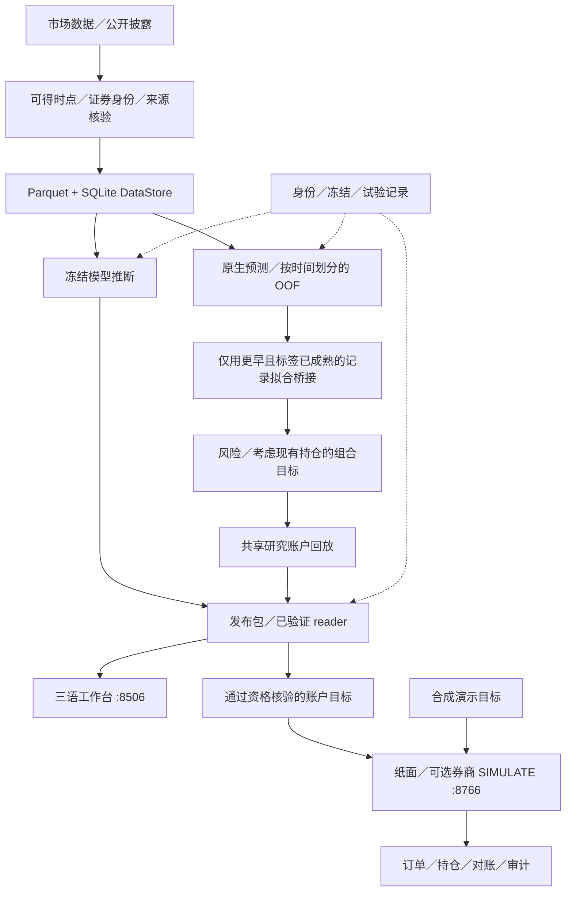

# US Tech Quant v21

**面向美股的时点一致量化研究、冻结模型推断与模拟执行项目。**

[English](../README.md) · [中文](README.zh.md) · [日本語](README.ja.md)

[项目概览](#overview) · [架构](#architecture) · [技术设计](#engineering) · [研究边界](#research) · [快速启动](#quickstart) · [验证](#verification) · [源码导航](#navigation)

开发快照：**2026-10-18**。当前产品将技术讲解、方法比较、研究记录、数据图表和每日模拟整合为一个中日英三语工作台。这里发布源码、测试和小型配置；数据集、冻结模型、账户状态与研究账本保存在各自配置的外部存储根。

<a id="overview"></a>
## 已实现的能力

| 领域 | 当前能力 | 状态含义 |
| --- | --- | --- |
| 数据与信息可得性 | Parquet / SQLite DataStore、来源谱系、历史证券身份、13F 披露和修订时点 | 输入必须满足决策时的信息截止要求；缺少身份或来源证据时明确保留缺口 |
| 模型与组合 | 原生预测、按时间划分的折外预测桥接、风险估计、考虑现有持仓的组合目标、共享账户回放 | 研究实现与冻结展示策略分别保留身份和验收状态 |
| 统一工作台 | 中文／日文／英文；技术展厅、方法案例、机器学习检查、数据图表、每日模拟 | 分区和历史按需加载；打开页面不启动采集、拟合、回放或下单 |
| 方法展示 | 八套方法查询目录、可修订的五套方法展面 | 展面名单、纸面账本成员、券商策略绑定分别管理，由各自当前 owner 记录决定 |
| 模拟与对账 | 本地纸面账本、可选 Moomoo SIMULATE 连接、目标与持仓差异、订单生命周期及审计记录 | 研究目标、账户目标、纸面模拟成交和券商确认成交分别标识；不提供 REAL 下单能力 |
| 研究与存储治理 | 内容绑定身份、失败试验记录、冻结引用、外部存储路由及仓库体积检查 | 工程检查证明其覆盖的行为；策略有效性需要另行获准的证据 |

公开项目名称保留 **v21**。源码路径中的 `V22`、`A2`、`FAST3` 和 `FAST6` 指内部流水线或研究系列。文件名或界面中出现某种方法，不能证明它已被采纳。

<a id="architecture"></a>
## 架构



图中描述的是模块职责。研究回放、已发布历史曲线、纸面账户与券商模拟分别保留各自的时钟和执行口径。界面中的研究曲线不是账户成交记录。

主要数据和建模工具包括 Python、Pandas、NumPy、PyArrow、SQLite 与 scikit-learn。工作台使用 Streamlit 和 Altair；独立模拟服务使用 Python 标准库。可选的提升树、神经网络及券商依赖由各组件单独维护。

<a id="engineering"></a>
## 技术设计

**按信息实际可得时点重建输入。** [13F PIT 模块](../scripts/v22/pit_13f_reconstruction_r1.py) 使用接收时间戳、纽约决策截止时点、修订语义及历史证券身份。决策截止后才披露的文件不能用于该次决策。季度生效的管理人名单来自[共享刷新模块](../scripts/storage/refresh_13f_quarter.py)。

**保留模型输出的原生含义。** 概率、排名、收益和分位数含义不同。[原生预测桥接](../scripts/research/a2/ensemble/joint_oof_bridge.py) 保留各自坐标，仅使用更早且标签已成熟的折外记录拟合缩放和 Ridge 桥接。每个日期的总权重相同。对应[测试](../tests/research/a2/ensemble/test_joint_oof_bridge.py) 定义标签成熟边界及追加未来记录不改变更早拟合的检查。

**将不可交易持仓纳入组合约束。** [组合策略](../scripts/research/a2/inference/joint_portfolio_policy.py) 为锁定持仓预留资金与仓位名额；目标无法通过资格核验时保留实际持股单位。持仓数量求解器采用确定性近似方法，不保证全局最优。[测试](../tests/research/a2/inference/test_joint_portfolio_policy.py) 覆盖预留持仓、不可行目标及权重上限。

**只加载当前请求的展示内容。** [工作台](../apps/demo_console/README.md) 复用已发布数据 reader 与共享账户组件。方法讲解不加载模型或生成研究结果。缺失记录、资格核验失败和来源日期差异持续可见；切换语言或展示模式不改变原研究与账户权限。

<a id="research"></a>
## 研究边界

训练和开发验证，包括预处理拟合、特征选择、校准、早停及模型选择，必须使用严格早于 **2026-01-01** 的内容。测试观测与目标限于 **2026-01-01 ≤ 时间 < 2027-01-01**，并继续服从各组件更早的截止、信息实际可得性及标签成熟要求。

A2 的 2026 窗口已经暴露，不能重新称为未见过的独立留出集。冻结推断只应用已有变换与模型，不更新拟合状态。历史失败和冻结身份继续保留在证据中。FAST3 按现有契约仍仅开展合成开发；受保护的 Confirmation 内容不是普通开发输入。

界面讲解原生方法及其决策链，不会将探索实现自动变为已接受策略，也不把任何方法评为普遍最优。[项目地图](../docs/PROJECT_MAP.md) 用于定位 owner 与契约；已接受注册表和 manifest 才确定身份及状态。

<a id="quickstart"></a>
## 运行项目

### 公开源码：离线模拟

需要 Windows、PowerShell，以及 PATH 中可用的 Python 3.12。手动演示使用合成目标与价格，无需 Streamlit、Moomoo SDK、OpenD 或研究数据集。

在独立 PowerShell 窗口中运行，为本次演示创建新的外部状态目录：

```powershell
git clone https://github.com/kinryukii/us-tech-quant-v21.git
Set-Location us-tech-quant-v21
$env:USTQ_DAILY_ROOT = Join-Path $env:LOCALAPPDATA 'US Tech Quant\demo-daily'
$demoState = Join-Path $env:USTQ_DAILY_ROOT ('paper-' + [guid]::NewGuid().ToString('N'))
python -B -m apps.moomoo_trading_component.moomoo_component `
  --repo-root $PWD.Path --data-dir $demoState --port 8766
```

打开[模拟工作台](http://127.0.0.1:8766/)，依次操作 **载入离线演示 → 预览订单与风控 → 执行一轮**，然后检查持仓及审计记录。演示保持手动纸面模式。按 `Ctrl+C` 停止服务。

### 已配置的本机环境：统一工作台

完整工作台需要外部 `demo-console` 环境及通过资格核验的发布产物。使用现有产品启动器：

```powershell
Set-Location D:\us-tech-quant
.\打开DEMO.ps1
```

打开[统一工作台](http://127.0.0.1:8506/)。账户组件从 **8766** 端口嵌入。打开工作台本身不会激活策略调度。读取真实研究记录仍需适用访问授权；克隆源码不包含外部数据集或冻结模型。

明确需要日更时，在已配置环境执行：

```powershell
.\更新今日推荐.ps1
```

更新会恢复已接受阶段，并保留来源核验、过程锁、资源门槛和最近已验证截止日。只有明确需要同日重新采集时才使用 `-RefreshData`。完成后在工作台重新加载发布缓存。前置条件与恢复方式见[日更说明](../docs/daily_recommendation.md)。

`requirements.lock.txt` 是基础环境快照。[工作台依赖](../apps/demo_console/requirements.txt) 与[可选券商依赖](../apps/moomoo_trading_component/requirements-moomoo.txt) 分别维护。

<a id="verification"></a>
## 验证

**2026-10-18**，已配置的默认合成测试结果为 **743 passed, 1 skipped**。一项 Windows PowerShell 检查因本机执行策略限制而跳过，原策略保持不变；此结果只覆盖指定工程测试。

[pytest.ini](../pytest.ini) 将默认验收明确限定为已审阅的合成存储、维护、日更协调与服务生命周期测试。在已配置仓库根目录运行，不额外指定宽泛测试目录：

```powershell
Set-Location D:\us-tech-quant
$projectPython = 'D:\us-tech-quant-envs\us-tech-quant-main\Scripts\python.exe'
$cacheRoot = (& $projectPython -B -c "from scripts.common.storage_paths import resolve; print(resolve().cache_root)").Trim()
$verificationRoot = Join-Path $cacheRoot ('_maintenance\readme-verification-' + [guid]::NewGuid().ToString('N'))
& $projectPython -B -m pytest -q `
  --basetemp (Join-Path $verificationRoot 'tmp') `
  -o "cache_dir=$(Join-Path $verificationRoot 'pytest-cache')"
```

额外组件与研究测试须先审阅导入、输入、子进程及输出范围。默认测试不是全仓库覆盖。本次同步不采集供应商历史数据、不运行真实数据研究、不启动现有账户，也不验证实盘交易。

<a id="navigation"></a>
## 源码导航

| 用途 | 入口 |
| --- | --- |
| 统一工作台与展示行为 | [工作台 README](../apps/demo_console/README.md) |
| 模拟、账户绑定与订单生命周期 | [模拟组件 README](../apps/moomoo_trading_component/README.md) |
| 每日发布与恢复 | [日更说明](../docs/daily_recommendation.md) |
| 项目导航与证据规则 | [项目地图](../docs/PROJECT_MAP.md)、[文档索引](../docs/README.md) |
| 数据目录与 PIT 输入 | [数据层说明](../docs/DATA_LAYER.md)、[DataStore](../scripts/storage/storage_r2a.py) |
| 原生预测与组合研究 | [OOF 桥接](../scripts/research/a2/ensemble/joint_oof_bridge.py)、[风险估计](../scripts/research/a2/risk/joint_risk_estimators.py)、[组合策略](../scripts/research/a2/inference/joint_portfolio_policy.py) |
| 研究身份与失败试验 | [注册表](../scripts/maintenance/research_registry.py)、[生命周期](../scripts/maintenance/prospective_research_lifecycle.py) |
| 仓库布局与退役源码恢复 | [仓库布局](../docs/governance/REPOSITORY_LAYOUT.md)、[研究导航](../docs/research/README.md) |
| 存储与体积政策 | [存储说明](../docs/STORAGE_LAYOUT.md)、[Anti-Bloat 政策](../docs/governance/ANTI_BLOAT_POLICY.md) |

[共享配置](../config/storage_paths.json) 和[路径解析器](../scripts/common/storage_paths.py) 将数据、环境、缓存、实验、报告与日常状态路由到不同的外部根目录。这些运行产物与 GitHub 源码快照分别保存。
